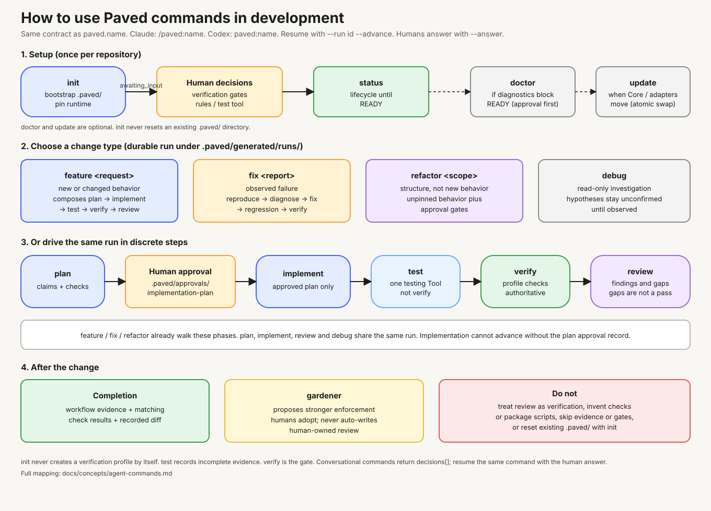
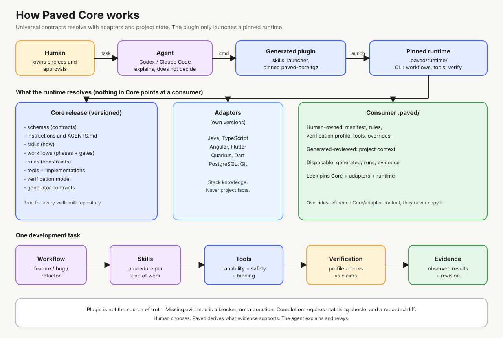

# Paved

Paved is the tool I use to keep coding agents (Claude Code, Codex, Cursor) honest when
they work on a real repository.

I started it after too many sessions that went the same way: the agent picked the wrong
test command, ignored how the project was organized, changed the plan halfway through
without saying so, and then wrote "all tests pass" without having run them. None of that
is a model problem you can prompt away. It's a process problem, so I wrote the process
down and made the agent go through it.

In practice Paved is a TypeScript CLI plus a plugin for each agent. The plugin gives the
agent skills and commands; the CLI decides what is allowed and records what happened.

## What it does

A change goes through one run with three commands:

- `intent` takes the request as you'd say it, decides whether it's a feature, a bug fix
  or a refactor (or asks you when it can't tell), and gathers context. For a bug it wants
  a failing regression test first; for a refactor, a passing baseline.
- `plan` writes the plan to `.paved/documents/plans/`. You read it, comment on it in a
  local Markdown preview if you want, and approve it in the conversation. The agent
  can't approve on your behalf.
- `execute` implements the plan, runs the project's tests and verification checks,
  records the evidence and has a separate subagent review the change before the run
  completes.

If you'd rather not think about the steps, `execute "<request>"` does it all from one
command: it sets Paved up if the repository doesn't have it yet (or updates it), works through the
request and still stops for your answers and for your approval of the plan.



The parts I care most about:

- Commands are declared, not guessed. A Check names a Tool, a Tool has an implementation
  per project, and Paved runs exactly that. When it doesn't know how to test something
  it says so and asks instead of inventing a command from `package.json`.
- Evidence is checked, not trusted. Every check result records the revision, the
  working tree digest and the exit code, and a record that claims more than its own
  observations support is rejected.
- Human decisions stay human. An approval records who made it, a run refuses to go on
  when the run and the approval record disagree, and changing an approved plan needs a
  new approval.
- Everything lives in the repository under `.paved/`, so runs can be resumed, reviewed
  and versioned with the code.

Paved doesn't make the code correct. It makes it much harder for an agent to skip steps
quietly, and easy to see afterwards what was actually checked and what wasn't.



## Trying it

Install the plugin for your agent:

```bash
# Claude Code
claude plugin marketplace add andersonmrodrigues/paved
claude plugin install paved@paved

# Codex
codex plugin marketplace add andersonmrodrigues/paved
codex plugin add paved@paved
```

In Cursor: **Customize → Plugins → From GitHub Repository**, import
`https://github.com/andersonmrodrigues/paved` and install Paved.

Then, inside the repository you want to work on, run `/paved:init` in Claude Code
(`paved:init` in Codex, `/init` in Cursor), and start a change with `intent`.

The plugin carries its own runtime and installs it under `.paved/runtime/`, so nothing is
added to your application's dependencies. The [installation guide](docs/getting-started/installing-the-plugin.md)
covers updates and troubleshooting, and [Integrating a repository](docs/getting-started/integrating-a-repository.md)
covers project context and verification.

Besides the three main commands there are `status`, `update`, `preview`, and CLI-only
subcommands (`test`, `verify`, `doctor`, `gardener`, `generate`) meant for CI. The
[command reference](docs/concepts/agent-commands.md) has the details.

## How it's built

- `core/` holds what is the same for every project: skills, workflows, rules, tools and
  checks. It has no technology-specific knowledge.
- `adapters/` add that knowledge: Git, Java, Quarkus, TypeScript, Angular, Dart, Flutter
  and PostgreSQL so far.
- `schemas/` has a JSON Schema for every document Paved reads or writes, and the CLI
  validates against them on every load.
- `cli/` is the runtime, and `plugins/` is generated from the sources, with a test that
  fails if the two drift.

There are a little under a thousand tests, many of them driving the real CLI against
temporary Git repositories. Larger design choices are written down in
[docs/decisions](docs/decisions/README.md) and the [architecture notes](docs/concepts/architecture.md).

I use Paved on my own projects, and most fixes come from that. Version 2.6.0, for
example, came out of building a [payment ledger service](https://github.com/andersonmrodrigues/payment-ledger-service)
with it, where a few runs got stuck in ways the tests hadn't covered.

## Status

It's a personal project, used by me and not much tested outside my own repositories.
The plugins are installed straight from this repository; Paved isn't in any public plugin
directory and isn't published to npm. Changes are listed in the [changelog](CHANGELOG.md).

If you want to try it or poke at the code, [CONTRIBUTING.md](CONTRIBUTING.md) has the
setup. Issues and pull requests are welcome.

[MIT License](LICENSE)
