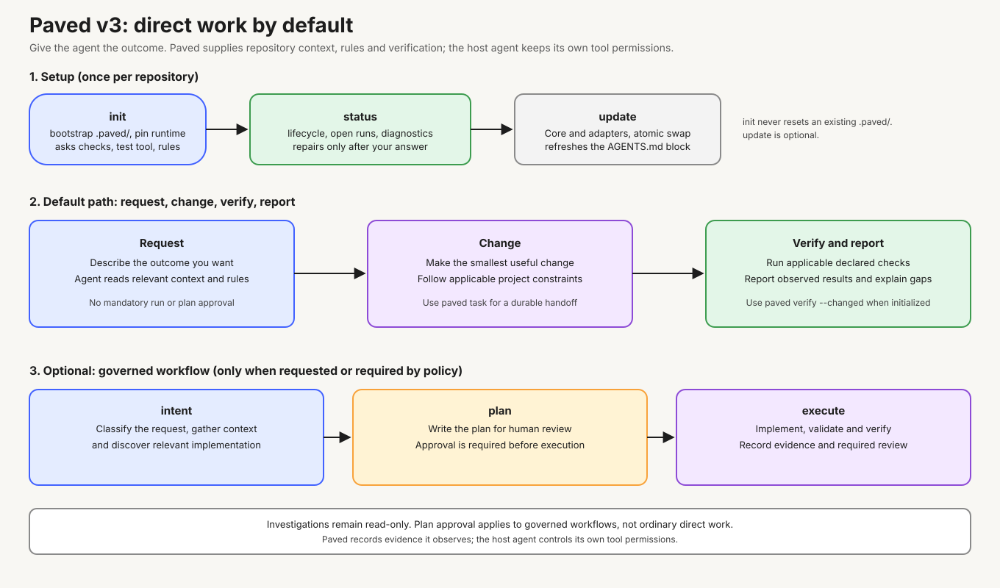
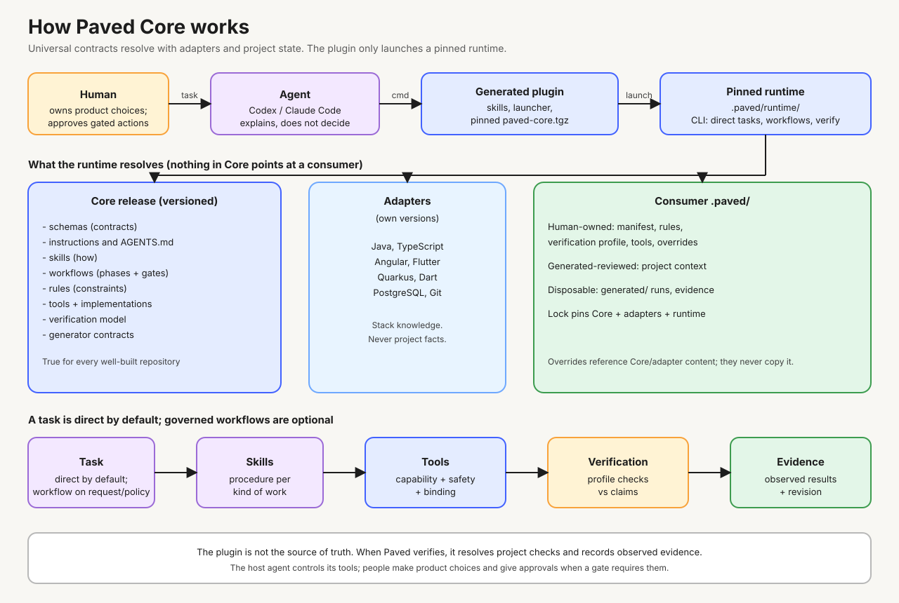

# Paved

Paved is the tool I use to keep coding agents (Claude Code, Codex, Cursor) honest when
they work on a real repository.

I started it after too many sessions that went the same way: the agent picked the wrong
test command, ignored how the project was organized, changed the plan halfway through
without saying so, and then wrote "all tests pass" without having run them. None of that
is a model problem you can prompt away. It's a process problem, so I wrote the process
down and made the agent go through it.

In practice Paved is a TypeScript CLI plus a plugin for each agent. Core v3 defaults to
direct, outcome-focused work: the agent uses repository context and rules, runs applicable
checks, and reports what it verified. The project-local CLI validates declared checks and
records observed evidence; the host agent still controls its own tool permissions.

## How Paved works

### Direct work by default

Ordinary requests take the direct path. Describe the outcome you want; there is no
mandatory run, phase sequence or plan approval. Keep small tasks in the conversation.
For work that needs a durable handoff, `paved task` can start, note, resume or complete a
task without creating a workflow run.

Use the phase-based `intent` → `plan` → `execute` workflow only when you request it or a
project rule requires it. It gathers context and discovery, records a plan for your
approval, then implements and completes its configured validation, verification, evidence
and review phases. Investigation-only requests remain read-only.



The parts I care most about:

- Commands are declared, not guessed. A Check names a Tool, a Tool has an implementation
  per project, and Paved runs exactly that. When it doesn't know how to test something
  it says so and asks instead of inventing a command from `package.json`.
- Evidence is checked, not trusted. Every check result records the revision, the
  working tree digest and the exit code, and a record that claims more than its own
  observations support is rejected.
- Human decisions stay human. Governed workflows bind approval to the plan and run;
  delivery approvals bind to the exact target and patch. Changing an approved plan needs
  a new approval.
- Paved keeps its workflow documents and state under `.paved/`, so work can be resumed
  and inspected. Durable project context and plans can be reviewed and committed with
  the code; generated run records and local evidence are disposable and can be regenerated.

Paved doesn't make the code correct. It makes the work and its verification easier to
inspect; governed workflows add explicit phases and approval gates when they are needed.



## Trying it

Install the plugin for your agent:

```bash
# Claude Code
claude plugin marketplace add andersonmrodrigues/paved
claude plugin install paved@paved

# Codex
codex plugin marketplace add andersonmrodrigues/paved
codex plugin add paved@paved
```

In Cursor: **Customize → Plugins → From GitHub Repository**, import
`https://github.com/andersonmrodrigues/paved` and install Paved.

Then, inside the repository you want to work on, initialize Paved once:

```text
Claude Code: /paved:init
Codex:       paved:init
Cursor:      /init
```

After initialization, ask the agent directly, for example: "Add a health check
endpoint." For a governed change, explicitly use `intent`, `plan` and `execute`; the
plan requires your approval before implementation. See the
[command reference](docs/concepts/agent-commands.md).

In initialized repositories, Claude Code and Codex receive guidance to use the direct
path for ordinary requests, without a Paved command. Governed workflows remain available
when explicitly requested or required by project policy. This is agent guidance, not a
host-level tool restriction; trust and enable the plugin hooks for per-prompt reminders.

The plugin carries its own runtime and installs it under `.paved/runtime/`, so nothing is
added to your application's dependencies. The [installation guide](docs/getting-started/installing-the-plugin.md)
covers updates and troubleshooting, and [Integrating a repository](docs/getting-started/integrating-a-repository.md)
covers project context and verification. The [component catalog](docs/catalog.md) helps
you find the included adapters, workflows and examples.

Useful commands include `context` to retrieve relevant project guidance, `task` for a
durable handoff, `status` and `update` for installation health, and `review` and
`verify` for change assessment. Other CLI commands include `doctor`, `gardener`,
`generate` and `test`. The
[command reference](docs/concepts/agent-commands.md) has the details.

## How it's built

- `core/` holds what is the same for every project: skills, workflows, rules, tools and
  checks. It has no technology-specific knowledge.
- `adapters/` add that knowledge: Git, Java, Quarkus, TypeScript, Angular, Dart, Flutter
  and PostgreSQL so far.
- `schemas/` has a JSON Schema for every document Paved reads or writes, and the CLI
  validates against them on every load.
- `cli/` is the runtime, and `plugins/` is generated from the sources, with a test that
  fails if the two drift.

The test suite exercises the CLI against temporary Git repositories, alongside adapter,
plugin and contract checks. Larger design choices are written down in
[docs/decisions](docs/decisions/README.md) and the [architecture notes](docs/concepts/architecture.md).

For quick local feedback, `npm run check:fast` runs type checking and the fast
unit/contract profile. `npm run check` still runs every test. The marked E2E tests can
also be run with `npm run check:e2e`; GitHub Actions provides a manual `e2e` workflow
for that profile.

I use Paved on my own projects, and most fixes come from that. Version 2.6.0, for
example, came out of building a [payment ledger service](https://github.com/andersonmrodrigues/payment-ledger-service)
with it, where a few runs got stuck in ways the tests hadn't covered.

## Status

Core v3.0.0 is the current tagged release. Review the [Core v3 migration notes](CHANGELOG.md)
when upgrading from v2. It's a personal project, used by me and not much tested outside
my own repositories.
You can install the plugins from this GitHub repository as a marketplace source. Paved
isn't listed in the hosts' built-in public plugin directories, and `paved-core` isn't
published to npm. Changes are listed in the [changelog](CHANGELOG.md).

If you want to try it or poke at the code, [CONTRIBUTING.md](CONTRIBUTING.md) has the
setup. Issues and pull requests are welcome.

[MIT License](LICENSE)
