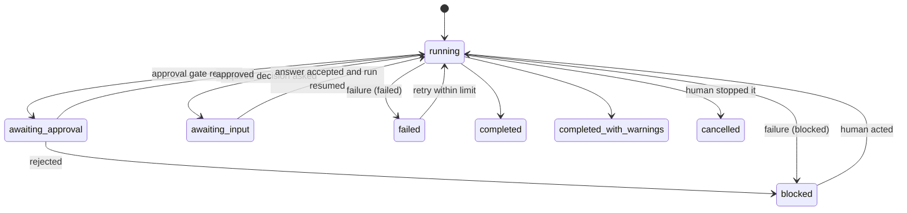

# Workflow state

A run of a workflow can be recorded as a `WorkflowRun` document
([schema](../../schemas/workflow-run.schema.yaml),
[template](../../core/templates/workflow-run.yaml)) under
`.paved/generated/runs/<id>.yaml`. The CLI now executes `feature`, `fix`, and
`refactor` by validating and advancing this record against the existing workflow
contract. An agent supplies observations and implementation changes; the runtime
enforces plan approval, invokes the governed testing Tool and verification
engine, and requires complete workflow evidence before completion. Optional
implementation delegation uses a bounded `DelegationPlan`; Paved validates task
dependencies, write scopes, concurrency and plan provenance, then records host-reported
execution metadata. The host agent owns native session creation and coordination.

## Model

| Field | Content |
|---|---|
| `workflow` | Id and version of the workflow run |
| `autonomy_profile` | Optional `guided`, `balanced` or `autonomous` choice; immutable per run once selected |
| `revision`, `started_at`, `ended_at` | Where and when; `ended_at` required for terminal statuses |
| `status` | `running`, `awaiting-approval`, `awaiting-input`, `completed`, `completed-with-warnings`, `failed`, `blocked`, `cancelled` |
| `inputs[]` | Every input as understood, with `source` (`human`, `ticket`, `repository`) |
| `phases[]` | One per workflow phase, in order: `status` (`pending`, `running`, `completed`, `skipped`, `failed`, `blocked`), `attempts`, `skip_reason`, `skills[]`, `gates[]`, `failure` |
| `failure` | The failure that ended or holds the run ([workflow failure](workflow-failure.md)) |
| `warnings[]` | Required when `completed-with-warnings` |
| `evidence` | Path of the evidence record; required when completed |
| `outputs[]` | What the run left behind (`kind`, `description`, `ref`) |
| `events[]` | Append-only log |
| `decisions[]` | Run-scoped decisions whose lifetime is this run |
| `delegation` | Optional pointer and integrity digest for the implementation task graph |
| `handoff` | Optional host-neutral checkpoint summary, changed paths, source/test fingerprint, revision and suggested next action |

Delegation plans live under `.paved/generated/delegations/<run-id>.yaml`, with concise
reports under `.paved/generated/delegation-results/<run-id>/`. Tasks declare
dependencies, exact read/write paths, output contracts and a capacity/effort policy. The
CLI only exposes ready tasks and records starts/results; it does not call model APIs or
create sessions. Claude Code and Codex execute work through their native agent/session
tools. The selected model and effort, session hash and optional token/cost/duration
figures are host-reported observations, not verified claims. Raw session ids, prompts
and credentials are not persisted. The workflow cannot leave implementation until all
registered tasks are completed, and each result still needs review and verification by
the primary agent.

## Selected execution context

At creation, `intent` and request-form `execute` accept `--autonomy`; this overrides
`workflow.autonomy.default_profile`. The explicit choice survives classification; an
unclassified run without one may acquire the chosen workflow's default at classification.
After selection, persistence and resume reject a changed profile. If neither selection
nor default exists, old runs remain valid with the field absent and existing behavior.
Run results expose the recorded value as `data.autonomy_profile` even when resuming with
a different command. See the [profile matrix](workflows.md#run-autonomy).

For an active phase, `intent`, `plan` and `execute` may return `data.phaseContext` with
`phase`, `goal`, composed `skills`, `tools.required` and `tools.optional`, ordered bound
`fragments` (`id`, `body`) and effective `toolPolicies` (`id`, `allow`, `ask`, `deny`).
`data.routing` remains separate. The workflow id and version identify the source
contract; fragments and policies are resolved from it on load rather than copied into
new run fields. Invalid Tool policies block runtime loading before dispatch. No profile,
fragment or Tool policy changes the required approvals, verification, evidence,
independent review or host permissions.

## Consistency

The schema checks field-level rules (a failed or blocked run has a failure; a skipped
phase has a reason; a decided gate names a person). `assessRun` checks the record
against its workflow: the same version and phases in the same order, required inputs
present once work started, no phase started before earlier ones are done, skips only
where `skip_when` exists, attempts within the retry limit, gates known and satisfied the
right way, at most one running phase, and failure codes consistent with status and retry
class.

## Events

| Event | When |
|---|---|
| `run-started`, `run-completed`, `run-failed`, `run-blocked`, `run-cancelled` | Run transitions |
| `phase-started`, `phase-completed`, `phase-skipped`, `phase-failed` | Phase transitions |
| `skill-activated` | A skill is activated or continued |
| `tool-invoked` | A tool is used (`ref`: tool id) |
| `verification-executed` | A check ran (`ref`: check id in the evidence) |
| `evidence-recorded` | Evidence was written or appended |
| `approval-requested`, `approval-decided` | A human decision was asked for or made |
| `decision-raised`, `decision-asked`, `decision-answered`, `decision-applied`, `decision-superseded` | A run-scoped decision changes state |
| `retry-started` | A new attempt of a phase began |
| `phase-reopened` | An approved plan amendment returned a phase to `pending`; the run goes back to implementation |
| `delegation-registered`, `delegation-task-started`, `delegation-task-completed`, `delegation-task-blocked`, `delegation-task-failed`, `delegation-superseded` | Delegation graph and task lifecycle observations |

## Plan approval

Planning writes an `awaiting-approval` gate tied to the SHA-256 digest of the
concrete plan file. The decision lives in `.paved/approvals/<run-id>.json` with
`run`, `plan_sha256`, `decision` (`approved` or `rejected`), `decided_by`, and
`decided_at`. The user approves in the conversation; after an explicit yes, the agent
runs the workflow with `--run <run-id> --approve`, which records the approval for the
current plan digest under the local user and resumes. A person may also write the file
directly, for example to reject. The runtime checks the file, decision, plan content
and recorded gate on every resume, and `--approve` refuses when the plan changed since
the request. The record rests on the agent following the instruction to approve only
after an explicit yes; teams requiring adversarial approval separation need an external
identity or signature authority.

For workflow Markdown plans, the canonical file is
`.paved/documents/plans/<run-id>.md`; `paved preview start
.paved/documents/plans/<run-id>.md` opens a local review, and a folder opens its
Markdown files together. Selected-text comments remain in
`.paved/generated/previews/`; the agent waits for them, marks each as being worked on
and resolves it with a reply after editing. The preview approves nothing. If the plan
changes during review, advancing the workflow issues a new approval request for its
current hash.

Events are append-only reporting and provenance. Approval and evidence events
are cross-checked against their referenced files when a run resumes. The
authoritative completion decision still comes from the evidence record.

During implementation, `execute --checkpoint --note <progress>` writes a portable
handoff into the run without advancing its phase. The handoff contains the agent's
concise progress note, changed paths, current revision and a SHA-256 fingerprint of
source and test files. Workflow results and `status` expose whether that fingerprint
still matches. A stale handoff is a cue to inspect the current diff and reconcile the
note; it never blocks resume or counts as verification. SessionStart hooks include
available handoffs so another supported host can continue from the same run. The
record contains no prompt transcript, session id or credentials.

## Independent review

The `review` phase counts only findings from a reviewer that did not write the change.
When the run reaches it, Paved writes a brief at
`.paved/generated/reviews/<run-id>-brief.md` naming the intent, plan, evidence, diff and
rules in scope, and the SHA-256 digests of the plan, the source and test files, and the
evidence record. The agent starts a subagent with its own context, gives it only the
brief, and the subagent writes a `ChangeReview` record at
`.paved/generated/reviews/<run-id>-findings.yaml`. Every coding agent Paved integrates
with can start subagents, so this is a precondition, not an option.

The agent passes the record with `paved execute --run <run-id> --auto --evidence
<record>`. Paved refuses it when `reviewer.isolated` is not `true`
(`PAVED_REVIEW_NOT_INDEPENDENT`) or when a digest differs from the run's current state
(`PAVED_REVIEW_STALE`), so a review of an older change cannot close the run. Isolation
is declared by the agent; like plan approval, it rests on the agent following the
instruction.

Each finding may carry a `proof` with the level the reviewer reached: `asserted`,
`cited`, `reasoned`, `executed` (a command running the real code shows the defect) or
`reproduced` (shown in the running system). A blocking finding needs `executed` or
`reproduced`, with the command and the SHA-256 of its captured output; otherwise Paved
refuses the record (`PAVED_REVIEW_FINDING_UNPROVEN`) and the reviewer proves the finding
or records it as a note. A record the user already decided on keeps that decision. Paved
does not re-run the command; the digest ties the claim to one captured output for a
person to check. Notes, at any level, are listed with their proof in the review
document. Blocking findings become a run
decision: `fix` reopens implementation, and the fix runs through tests, verification,
evidence and a new review; `accept` completes the run with the findings on record as
accepted by the user.

## Lifetime

Run records and local evidence live under `.paved/generated/`, are disposable and are
not committed by default. Durable plans and other work documents live under
`.paved/documents/` and are committed with the change. Teams that want a machine-readable
audit trail can commit run records or attach them to the change request.
