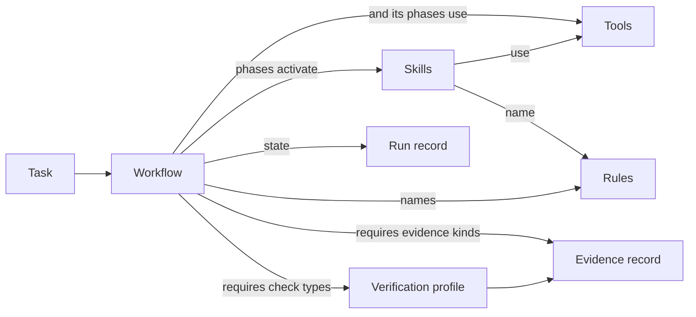

# Workflows

A workflow carries one class of change from request to verified completion. The Core
ships three: `feature`, `bug` and `refactor`. A performance improvement runs as `refactor`
(behavior unchanged) or `feature` (a new budget); the `performance`, `incident` and
`release` workflows were removed in Core 2.0 because nothing executed them
([ADR 0036](../decisions/0036-intent-plan-execute.md)). It is an
orchestration layer: it decides **which** phases run, **which** skills each phase
activates, **which** checks prove the result and **where** a human must decide. It never
says **how** to do the work; skills do. It never says what must hold; rules do. It
never runs a command; Checks name Tool capabilities, and a separate implementation
binding supplies an execution mechanism.



## Architecture

| Part | Where | Role |
|---|---|---|
| Contract | `workflow.yaml` ([schema](../../schemas/workflow.schema.yaml)) | What the run needs, does and must prove, as checkable data |
| Guidance | `WORKFLOW.md` (sections: When to use, Phases, Escalation; at most 80 lines) | Judgement calls the contract cannot express |
| Execution semantics | [`core/instructions/workflows.md`](../../core/instructions/workflows.md) | How any agent runs any workflow: preconditions, gates, failures, retries, completion |
| Run state | `.paved/generated/runs/<id>.yaml` ([schema](../../schemas/workflow-run.schema.yaml)) | What happened in one run ([workflow state](workflow-state.md)) |
| Checks | `cli/lib/workflows.ts` | Rules the schemas cannot express |

Execution semantics are written once, for all workflows, so each `WORKFLOW.md` stays
short and workflows cannot disagree about what `blocked` means.

## Contract

| Group | Fields | Notes |
|---|---|---|
| Required metadata | `id`, `title`, `description`, `version`, `status`, `change_type` | `description` says "Use when …"; `change_type` is the trigger |
| Optional metadata | `deprecation` (only when `deprecated`), `references` | Same lifecycle model as skills ([versioning](versioning.md#workflow-versions)) |
| Inputs | `inputs[] {id, description, required}` | A missing required input stops the run (`input-missing`); inputs are never invented |
| Context | `context {required, optional}` | Context areas, resolved through the manifest's `context_areas` |
| Preconditions | `preconditions[] {id, condition}` | Workflow-specific; the standard ones apply to every run |
| Execution configuration | `phases[]`: `phase`, `goal`, `skills`, `tools`, `verification`, `gates`, `skip_when`, `retry`, optional `routing`, `fragments`, `tool_policies` | [Workflow stages](workflow-stages.md) |
| Automation preference | Optional `autonomy.default_profile` | Default for a new run; never an approval or permission grant |
| Tool policies | Optional workflow-local `tool_policies[] {id, allow, ask, deny}` | Phases select local policy ids; see below |
| Rules | `rules[]` | Rules every run respects, besides those selected by `applies_to` |
| Completion | `evidence.required`, `outputs`, `completion.criteria` | Criteria add to the standard completion rule; they never relax it |

Deliberately absent: commands, paths, technologies, project names, and any field that
repeats a skill's procedure. A workflow names skills, tools, rules, check types and
evidence kinds by id or key.

## Run autonomy

New runs created by `intent` or `execute "<request>"` accept
`--autonomy <guided|balanced|autonomous>`. The explicit choice overrides the workflow's
optional `autonomy.default_profile`. An explicit choice survives pending classification;
otherwise the default is applied when classification selects the workflow. The selected
`autonomy_profile` is immutable per run, including across resume. If both are absent,
leave the field absent and preserve existing behavior.

| Profile | Phase continuation | Delegation |
|---|---|---|
| `guided` | Stop after each completed phase for the user to advance; even `execute --auto` completes at most one phase per call | Do not start delegated tasks automatically |
| `balanced` | Use `execute --auto` to continue eligible phases until a gate, required input, failure or new observation is needed | Host decides whether to start ready tasks |
| `autonomous` | Same continuation as `balanced` | Host automatically dispatches only ready tasks from an approved delegation plan, within its dependencies and scope |

All profiles preserve mandatory stops, gates, approvals, required input, verification,
evidence, independent review, completion requirements, Tool safety and host permissions.
Integrations carry out continuation and dispatch guidance; the CLI creates no agent
sessions. A profile is never consent to a gated action. See [workflow state](workflow-state.md)
for persistence and [agent integration](agent-integration.md) for the projection.

## Reusable workflow fragments

A `WorkflowFragment` is Core-owned metadata in
`core/workflow-fragments/<name>/fragment.yaml` with guidance in `FRAGMENT.md`. Its id is
`core.fragment.<name>` and must match the directory. Start from the
[templates](../../core/templates/README.md) and declare `apiVersion`, `kind`, `id`,
`title`, `version`, `status` and unique arrays of `inputs`, `skills` and `tools` (empty
arrays are valid). The [catalog](../catalog.md#workflow-fragments) lists built-ins.
Fragments cannot define phases, gates, triggers, lifecycle transitions or other fragments.
They reuse guidance without nested workflow runs or changes to the canonical phase order.

A phase includes fragments in order and binds every declared input:

```yaml
fragments:
  - id: core.fragment.context-discovery
    with:
      subject: the sibling feature closest to this one
```

Only the exact placeholder `{{ inputs.<id> }}` is interpolated, with one space on each
side and a declared kebab-case input id. Bindings must be nonblank strings with no
`{{` or `}}`; there are no expressions or recursive templates. The loader rejects
missing or extra bindings, undeclared inputs, unresolved placeholders (including altered
spacing), duplicate inclusion of an id in one phase, unknown references and nested
fragments. Resolution fails closed rather than returning partially bound phases.

Fragment skills append to phase skills in declaration order, deduplicating by id.
Fragment Tools become required phase Tools; required entries take precedence over
optional ones. Composition preserves the usual skill dependency, safety and quality
checks. `data.phaseContext.fragments` exposes ordered `{id, body}` entries with bound
guidance alongside the composed `skills` and `tools`; integrations consume these results
rather than rendering templates themselves.

## Skill composition

Phases list skills in activation order. A skill listed in several phases is activated
once and continued in later phases: `bug-investigation` spans discovery, planning and
implementation, and the phases mark where its gates sit. Skills activate their own
dependencies at the step that needs them ([skill composition](skill-composition.md)),
so a workflow must not list a skill that another listed skill already brings in as a
required dependency; the check reports it as duplicate activation. A missing required
skill fails reference resolution; an inapplicable skill is recorded as not applicable
in the run. Cycles are impossible because the skill graph is acyclic and phases only
move forward. At most three skills per phase: more means the phase is doing two things.

**No workflow composition.** Workflows do not invoke other workflows. A request that
mixes kinds of change is split by `intent` into separate runs, each with its own
classification. Nested runs would need shared state, nested failures and nested
approvals; the evidence of two separate runs is easier to review
([ADR 0015](../decisions/0015-workflow-contract.md)).

**Every Core workflow must be executable.** Every gate in a Core workflow contract has a
handler in `cli/lib/workflow-gates/`, and `tests/workflows/gates.test.ts` walks the Core
workflows to enforce it. A gate or workflow added to the Core fails that test until it
has handlers, so the Core never ships a contract nothing executes. Project workflows in
`.paved/workflows/` are guidance and are not executed.

## Rule resolution

A run respects the union of: the workflow's `rules`, the `rules` of every activated
skill, and every rule whose `applies_to` matches the change (paths, workflow id, change
type, adapter). Then overrides apply as in [inheritance](inheritance.md): Core, then
adapter, then project rules, then project overrides (`set-severity`, `disable`, never for
`overridable: false`). Listing a rule in a workflow does not change its severity. A
violated `error` rule blocks completion (`rule-violation`); a violated `warning` rule
makes the run `completed-with-warnings`.

## Tool resolution

A phase may use the tools it lists and those of its active skills. Required tools must
resolve; optional ones may be absent, and the step that needs them uses its fallback.
Tool safety holds through the workflow: a phase that can reach a `destructive` tool must
carry an approval gate and must not be retried automatically (checked). A Check names a
Tool capability. Tool resolution selects one compatible Core, adapter or explicitly
selected project implementation; discovery does not grant permission to execute it.

### Phase-scoped Tool policies

Declare local `tool_policies` on the workflow as `{id, allow, ask, deny}`, with a unique
local id and arrays of qualified Tool ids (empty arrays are valid). A phase selects
these definitions with `tool_policies: [<local-id>, ...]`. There is no separate ToolPolicy
document kind or policy execution mechanism.

- `allow` recommends the Tool capability; it never authorizes execution.
- `ask` requires the host's own approval flow before use; Paved plan approval does not
  replace host approval.
- `deny` excludes use in that phase, even if the host would otherwise permit it.

Selected policies do not add Tools to the phase. Selection order determines the first
occurrence of same-action duplicates; later copies are removed. There is no precedence
between actions: cross-action conflicts within a definition or across selected policies
are rejected. Unspecified Tools retain existing host behavior, as do phases without
selected policies. Host permissions remain authoritative and may always be stricter.

Authoring checks and runtime loading reject duplicate policy ids, unknown selected
policy ids, unknown Tool references and conflicting actions. Denying a required Tool is
invalid, including Tools contributed by a fragment, an active skill or its transitive
required skill dependencies. Validation runs after fragment composition and fails closed
before starting or advancing a workflow, including on resume; invalid policies are not
merely omitted from the projection. Effective actions appear in
`data.phaseContext.toolPolicies` as ordered `{id, allow, ask, deny}` entries. Integrations
apply restrictions through host controls without claiming Paved grants host permissions.

Paved's own testing and verification hooks inspect the concrete invocation set before
any selected Tool runs. This covers discovery, planning baselines, validation suites
and verification Check Tools, including Tools selected through a testing decision.
Deny blocks invocation; ask suspends `--auto` with a bounded `data.toolApproval` request
and `PAVED_WORKFLOW_TOOL_APPROVAL_REQUIRED` warning. After the host mediates its own
approval step, `--host-tool-approval <request-id>` acknowledges continuation for that
capability and visible safe parameters only. Sensitive values and opaque implementation
configuration are hidden and outside the acknowledgment. It grants and attests no host or
OS permission, is not persisted, and
is discarded at the next automatic phase boundary. Plan approval, policy `allow` and
Paved decision answers never substitute for that step. See the
[agent integration contract](agent-integration.md) for the request fields. Isolated review
briefs include only the active review phase's composed skills, Tools, bound fragment
bodies and effective policies.

## Verification and evidence

Verification is a phase of its own that cannot be skipped. Each phase may name
`verification.required` check types (each must pass for completion; a missing type is
recorded as a gap) and
`recommended` ones. A workflow that has an implementation phase must require at least one
check type in `verification` and at least one evidence kind, and a required check type
must be able to prove some claim (`build` cannot). The evidence record names the
workflow in `producer.workflow`; `assessWorkflowEvidence` checks it holds every required
check type of every phase and every required evidence kind, and `assessSkillEvidence`
does the same for the activated skills.

## Completion and outputs

| Outcome | Run status | Evidence `completion.status` |
|---|---|---|
| Completed | `completed` | `complete` |
| Completed with warnings | `completed-with-warnings` (warnings listed) | `complete`, with recommended omissions or warning rules |
| Failed | `failed` | `incomplete` |
| Blocked | `blocked` | `blocked` |

`outputs` declares what a completed run leaves: `change`, `evidence`, `review`,
`measurement`, `release-candidate`, `follow-up`, `context-update`. Failures, retries and
approvals are in [workflow failure](workflow-failure.md) and
[workflow approval](workflow-approval.md).

## Checks

| Check | Where |
|---|---|
| Required fields, phase shape, unskippable phases, retry shape, lifecycle status | Schema |
| Canonical order, unique gates, "Use when", no technology names, size, contract mentioned in `WORKFLOW.md` | `assessWorkflowQuality` |
| Verification required for code changes; required checks can prove something | `assessWorkflowQuality` |
| Destructive tools gated and not auto-retried; a `release` or `incident` change type carries its approval | `assessWorkflowQuality` |
| No duplicate activation; no deprecated skills; no sentences copied from skills | `assessWorkflowQuality` |
| Skills, tools and rules resolve | `resolveReferences` |
| Run records match their workflow | `assessRun` |
| Exact fragment bindings, known references and one-level composition | `loadWorkflowFragments`, `resolveWorkflowFragments`, `loadContract` |
| Local policy consistency, known Tools and no denied required Tool after composition | `assessWorkflowToolPolicies`, runtime `loadContract` |
| Immutable selected autonomy profile | Run persistence and command resume validation |
| Every Core gate has a handler | `tests/workflows/gates.test.ts` |
| Evidence satisfies the workflow | `assessWorkflowEvidence` |

## Influences

The contract borrows from established practice without depending on any of it:
explicit phases with human checkpoints where agents act on shared systems (Anthropic,
"Building effective agents"); retry classes with bounded attempts and non-retryable
errors (durable-execution retry policies); approval gates on deployment environments
(CI/CD protected environments); and incident phases of detection, containment,
recovery and follow-up (NIST SP 800-61).
